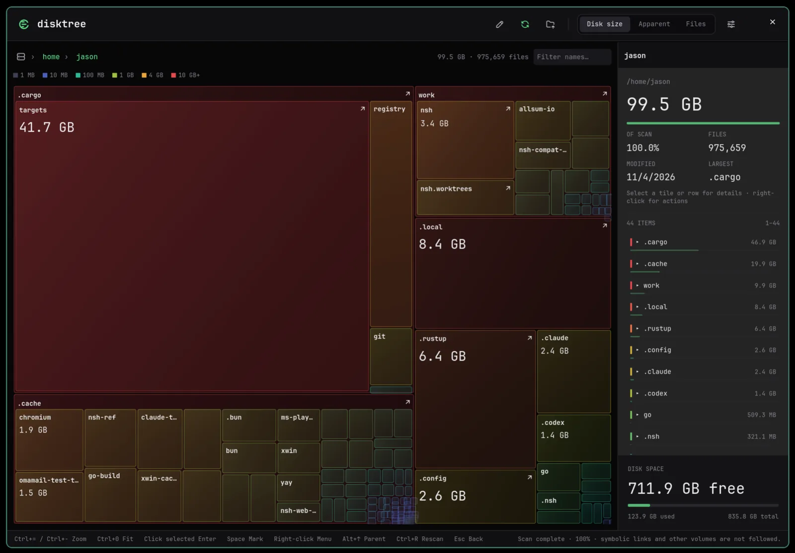

# huacnlee/cargo

**Stop deleting `target`.**

A drop-in Cargo fork for machines full of git worktrees and AI agents. They
share one build directory that stays under a size limit on its own, so you
never clean it and never rebuild from scratch. Install it and you are done:
there is nothing to configure.

https://huacnlee.github.io/cargo/



Five days straight on my Linux and macOS computers, with no `target` cleaned and
no full disk. All Rust build output on this machine is 41.7 GB.

Why and how I built it: [the background](https://huacnlee.github.io/cargo/why/) and
[my posts on X](https://huacnlee.github.io/cargo/why/#posts).

**If this helps you, please [sponsor me](https://github.com/sponsors/huacnlee).**

## 中文介绍

**不用再删 `target` 了。**

这是一个可以直接替换官方 Cargo 的分支，为同时跑大量 git worktree 和 AI Agent 的电脑而做。
所有 worktree 共用一个构建目录，它会自己控制在大小限制之内，所以不用清理，也不会再从头编译。
只需要安装，不需要任何配置。

在我的 Linux 和 macOS 电脑上已经连续用了 5 天，没有清理过 `target`，磁盘也没有再占满。上面
截图这台电脑的全部 Rust 构建产物一共 41.7 GB。

为什么做、怎么做的，见[项目背景](https://huacnlee.github.io/cargo/zh-CN/why/)和[我在 X 上的记录](https://huacnlee.github.io/cargo/zh-CN/why/#posts)。

**如果这个项目帮到了你，请[赞助我](https://github.com/sponsors/huacnlee)。**

## Install

```sh
curl -fsSL https://huacnlee.github.io/cargo/install.sh | sh
```

Windows (PowerShell):

```powershell
irm https://huacnlee.github.io/cargo/install.ps1 | iex
```

This replaces `~/.cargo/bin/cargo` and keeps the rustup proxy as
`cargo.rustup`.
`cargo +nightly` and `rust-toolchain.toml` keep working. If you have a nightly
toolchain, the installer adds its Cranelift component. `rustup self update`
reinstalls the proxy, so rerun the installer after it.

To uninstall and put the rustup proxy back:

```sh
curl -fsSL https://huacnlee.github.io/cargo/install.sh | sh -s -- --uninstall
```

Windows (PowerShell):

```powershell
& ([scriptblock]::Create((irm https://huacnlee.github.io/cargo/install.ps1))) -Uninstall
```

It keeps itself up to date: at most once a day, after a command, cargo checks
the latest release in the background and installs it the same way (checksum
verified, renamed into place, so running builds are not disturbed). Nothing
is printed; the last result is in `~/.cargo/.fork-update.log`. Set
`CARGO_FORK_AUTO_UPDATE=0` to turn it off; it is also off in CI (`CI` set).

Check which cargo is active:

```console
$ cargo -V
cargo 1.101.0 (ea4e34c28 2026-10-29) (huacnlee/cargo 0.102.0-1, https://huacnlee.github.io/cargo/)
```

## Results

[nsh](https://github.com/longbridge/nsh), a 525-crate workspace, dev build of
one binary on an 8-core Apple Silicon Mac, Rust 1.99 stable, no compiler
cache. Five fresh git worktrees of the same commit, built one after another,
one run:

| Worktree | Cargo | Disk, all worktrees | This fork | Disk, all worktrees |
|---|---:|---:|---:|---:|
| 1 | 111.4 s | 6.7 GB | 77.2 s | 3.7 GB |
| 2 | 106.4 s | 13.4 GB | 5.1 s | 4.0 GB |
| 3 | 108.6 s | 20.1 GB | 4.8 s | 4.4 GB |
| 4 | 93.8 s | 26.9 GB | 4.8 s | 4.8 GB |
| 5 | 87.6 s | 33.6 GB | 4.8 s | 5.1 GB |
| **Total** | **8.5 min** | **33.6 GB** | **1.6 min** | **5.1 GB** |

Cargo compiles everything again in each worktree. The fork compiles it once:
dependencies are shared, and so are your crates when their files are the
same, so each later worktree only links its binary. The shared build
directory stays under its size limit, twice the largest build of the last
day.

Editing and undoing in the second of two worktrees, median of three runs:

| Step | Cargo | This fork | Cargo, nightly | This fork, nightly ¹ |
|---|---:|---:|---:|---:|
| Edit a core crate | 9.1 s | 9.7 s | 10.4 s | 9.2 s |
| Edit it again | 8.7 s | 9.8 s | 11.8 s | 9.4 s |
| Undo the edit | 8.8 s | 3.4 s | 10.4 s | 3.2 s |
| Disk, both worktrees | 14 GB | 5.6 GB | 14 GB | 4.3 GB |

¹ Cranelift for your crates; Cargo uses LLVM.

An edit rebuilds about as fast as with Cargo on stable, up to a second
slower, including the first edit in a worktree that took every build from
another one. Undoing an edit, or switching back to a branch, reuses what was
built before.

### Across projects

Release builds of Cargo 1.99.0 and this fork, run one after another on the
same machine: nsh, then [mado](https://github.com/longbridge/mado) (a 330-crate
app in its own repository), then mado again from an empty build directory, as
a new worktree or `cargo clean` would start. One run each:

| Build | Cargo | This fork |
|---|---:|---:|
| nsh, first build | 207.9 s | 206.7 s |
| mado, first build after nsh | 513.8 s | 379.2 s |
| mado again, empty build directory | 513.8 s ¹ | 16.2 s |
| Disk after nsh and mado | 10.3 GB | 4.9 GB |

¹ Cargo compiles all 330 crates again, as in its first build; the fork
compiles 2 and takes the rest from `~/.cargo/targets/shared-deps/`.

mado builds its dependencies at `opt-level = 3` and nsh at 0, so the two share
almost nothing (1 of 330 crates); the fork is faster on mado's first build
because dependencies carry no debug info. The fork's 4.9 GB is both project
directories (2.3 GB and 0.4 GB) plus the shared dependencies (2.2 GB).

## What changes

- **One build directory per project.** Your crates build in
  `~/.cargo/targets/<name>-<hash>/`; the hash comes from the repository's main
  `.git` directory, so every worktree lands there wherever it is created.
  Binaries still appear in `./target`.
- **Fixed directories.** `./target` and `~/.cargo/targets` cannot be moved:
  `--target-dir`, `CARGO_TARGET_DIR`, `build.target-dir` and `build.build-dir`
  are ignored with a warning, so no flag, env var or tool can scatter build
  output elsewhere.
- **Dependencies are shared by every project.** Registry and git dependencies
  build once in `~/.cargo/targets/shared-deps/` and are reused by any project
  that needs the same version, features and profile, the way Go's build cache
  works. `cargo check`, clippy, rust-analyzer and `cargo doc` use the same
  builds instead of checking each dependency again: after a build, a check
  only looks at your own crates.
- **Your own crates are shared by worktrees too.** A workspace crate is keyed
  by the content of its files instead of the checkout it is in, so a new
  worktree of the same commit reuses every crate another worktree built, and
  switching back to a branch reuses what it built before. Editing a test or a
  binary rebuilds only that target. Crates with a build script, and crates
  that read their own path (`env!("CARGO_MANIFEST_DIR")`), still build per
  worktree. Worktrees also share rustc's incremental caches, so the first
  edit in a new worktree is incremental too. For this rustc records `.` as
  the compile directory (`-Zremap-cwd-prefix=.`; on stable through
  `RUSTC_BOOTSTRAP=1` with no `#![feature]` allowed), so start a debugger
  from the workspace root.
- **It cleans itself.** After a build, at most once an hour, the project's
  units unused for a day are removed, then the least recently used ones until
  it fits twice its largest build of the last day. Shared dependencies are
  kept for 7 days, so a project you come back to after a weekend still finds
  them, and fit 50 GiB. Projects no build has used for 7 days (a deleted
  checkout, a repository you stopped working on) are removed whole.
  The units an edit replaces are removed right away, unless another worktree
  uses them. A shared dependency rebuilt because something below it changed
  (a `cargo update`, another project's lockfile, a new snapshot of a git
  dependency) keeps only its newest build for the week; the older ones go
  after a day. Directories in `CARGO_TARGET_TMPDIR` nothing wrote to for a
  day go too, and so do binaries in `./target` whose build unit was removed
  (they would otherwise keep its whole size). Nothing a running build has
  locked is removed.
- **No duplicate object files on macOS.** Debuggers and backtraces read the
  objects inside each rlib, so the loose copies rustc leaves beside it are
  removed.
- **Worktrees build at the same time.** Fine-grained locking is on. When two
  builds need the same dependency at once, one compiles it and the other
  reuses the result.
- **Less debug info in dev builds.** Line tables for workspace members, none
  for dependencies. A `debug` setting in your profile still wins.
- **Metadata stored once on nightly.** An rlib normally carries a copy of its
  `.rmeta`; on a nightly rustc it no longer does (`-Zembed-metadata=no`, as
  upstream does for a nightly Cargo), about 30% off the shared dependencies.
- **Cranelift on nightly.** `cargo build` compiles local crates with Cranelift
  and runs the front end on up to 8 threads (`-Zthreads`). Tests and release
  builds keep LLVM.

All of these are defaults. To change one:

```toml
# ~/.cargo/config.toml
[build.gc]
max-size = "auto"     # or "15 GiB", "none"
shared-max-size = "50 GiB"  # shared dependencies; or "none"
max-unused = "1 day"
shared-max-unused = "7 days"  # shared dependencies and idle projects
frequency = "1 hour"  # or "always", "never"
enabled = true
```

`CARGO_SHARED_DEPS=0` keeps dependencies in the project's build directory;
`CARGO_CHECK_SHARED_DEPS=0` only checks them in `cargo check`;
`CARGO_SHARE_WORKSPACE_UNITS=0` builds your crates per worktree;
`CARGO_DEV_CRANELIFT=0` keeps LLVM on nightly; `CARGO_RUSTC_THREADS=1` makes
the front end single-threaded.

---

# Cargo

Cargo downloads your Rust project’s dependencies and compiles your project.

**To start using Cargo**, learn more at [The Cargo Book].

**To start developing Cargo itself**, read the [Cargo Contributor Guide].

[The Cargo Book]: https://doc.rust-lang.org/cargo/
[Cargo Contributor Guide]: https://rust-lang.github.io/cargo/contrib/

> The Cargo binary distributed through with Rust is maintained by the Cargo
> team for use by the wider ecosystem.
> For all other uses of this crate (as a binary or library) this is maintained
> by the Cargo team, primarily for use by Cargo and not intended for external
> use (except as a transitive dependency). This crate may make major changes to
> its APIs.


## Compiling from Source

### Requirements

Cargo requires the following tools and packages to build:

* `cargo` and `rustc`
* A C compiler [for your platform](https://github.com/rust-lang/cc-rs#compile-time-requirements)
* `git` (to clone this repository)

**Other requirements:**

The following are optional based on your platform and needs.

* `pkg-config` — This is used to help locate system packages, such as `libssl` headers/libraries. This may not be required in all cases, such as using vendored OpenSSL, or on Windows.
* OpenSSL — Only needed on Unix-like systems and only if the `vendored-openssl` Cargo feature is not used.

  This requires the development headers, which can be obtained from the `libssl-dev` package on Ubuntu or `openssl-devel` with apk or yum or the `openssl` package from Homebrew on macOS.

  If using the `vendored-openssl` Cargo feature, then a static copy of OpenSSL will be built from source instead of using the system OpenSSL.
  This may require additional tools such as `perl` and `make`.

  On macOS, common installation directories from Homebrew, MacPorts, or pkgsrc will be checked. Otherwise it will fall back to `pkg-config`.

  On Windows, the system-provided Schannel will be used instead.

  LibreSSL is also supported.

**Optional system libraries:**

The build will automatically use vendored versions of the following libraries. However, if they are provided by the system and can be found with `pkg-config`, then the system libraries will be used instead:

* [`libcurl`](https://curl.se/libcurl/) — Used for network transfers.
* [`libgit2`](https://libgit2.org/) — Used for fetching git dependencies.
* [`libssh2`](https://www.libssh2.org/) — Used for SSH access to git repositories.
* [`libz`](https://zlib.net/) (AKA zlib) — Used by the above C libraries for data compression. (Rust code uses [`zlib-rs`](https://github.com/trifectatechfoundation/zlib-rs) instead.)

It is recommended to use the vendored versions as they are the versions that are tested to work with Cargo.

### Compiling

First, you'll want to check out this repository

```
git clone https://github.com/rust-lang/cargo.git
cd cargo
```

With `cargo` already installed, you can simply run:

```
cargo build --release
```

## Adding new subcommands to Cargo

Cargo is designed to be extensible with new subcommands without having to modify
Cargo itself. See [the Wiki page][third-party-subcommands] for more details and
a list of known community-developed subcommands.

[third-party-subcommands]: https://github.com/rust-lang/cargo/wiki/Third-party-cargo-subcommands


## Releases

Cargo releases coincide with Rust releases.
High level release notes are available as part of [Rust's release notes][rel].
Detailed release notes are available in the [changelog].

[rel]: https://github.com/rust-lang/rust/blob/master/RELEASES.md
[changelog]: https://doc.rust-lang.org/nightly/cargo/CHANGELOG.html

## Reporting issues

Found a bug? We'd love to know about it!

Please report all issues on the GitHub [issue tracker][issues].

[issues]: https://github.com/rust-lang/cargo/issues

## Contributing

See the **[Cargo Contributor Guide]** for a complete introduction
to contributing to Cargo.

Code documentation: <https://doc.rust-lang.org/nightly/nightly-rustc/cargo/>

## More projects

- [Disktree](https://huacnlee.github.io/disktree/) — A native disk-space explorer for macOS and Linux. See what fills your disk as a nested treemap, and review every path before removing anything.
- [Omasend](https://huacnlee.github.io/omasend/) — A native LocalSend client. Share files, folders, screenshots, and text over your local network, with no account or cloud upload.
- [Omamail](https://huacnlee.github.io/omamail/) — A native email and calendar app with multiple accounts and keyboard navigation. Runs as an Omarchy plugin or a standalone desktop app.
- [Noop](https://huacnlee.github.io/noop/) — Your own AI team. Claude Code and Codex agents on your own computers do the daily work and only ask when something really needs you.
- [omarchy-mihoro](https://github.com/huacnlee/omarchy-mihoro) — An Omarchy bar panel for Mihoro. Monitor your proxy, switch between Rule, Global, and Direct modes, and manage subscriptions.
- [omarchy-which-key](https://github.com/huacnlee/omarchy-which-key) — Which Key for the desktop. Hold Super to see a shortcut guide drawn from your active Omarchy and Hyprland keybindings.

## License

Cargo is primarily distributed under the terms of both the MIT license
and the Apache License (Version 2.0).

See [LICENSE-APACHE](LICENSE-APACHE) and [LICENSE-MIT](LICENSE-MIT) for details.

### Third party software

This product includes software developed by the OpenSSL Project
for use in the OpenSSL Toolkit (https://www.openssl.org/).

In binary form, this product includes software that is licensed under the
terms of the GNU General Public License, version 2, with a linking exception,
which can be obtained from the [upstream repository][1].

See [LICENSE-THIRD-PARTY](LICENSE-THIRD-PARTY) for details.

[1]: https://github.com/libgit2/libgit2

